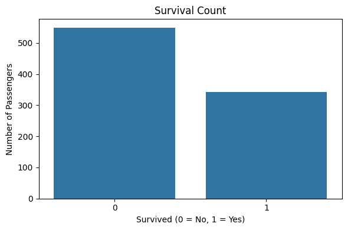
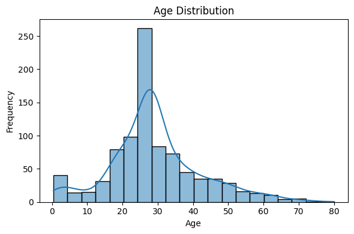
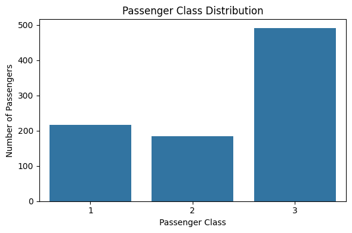
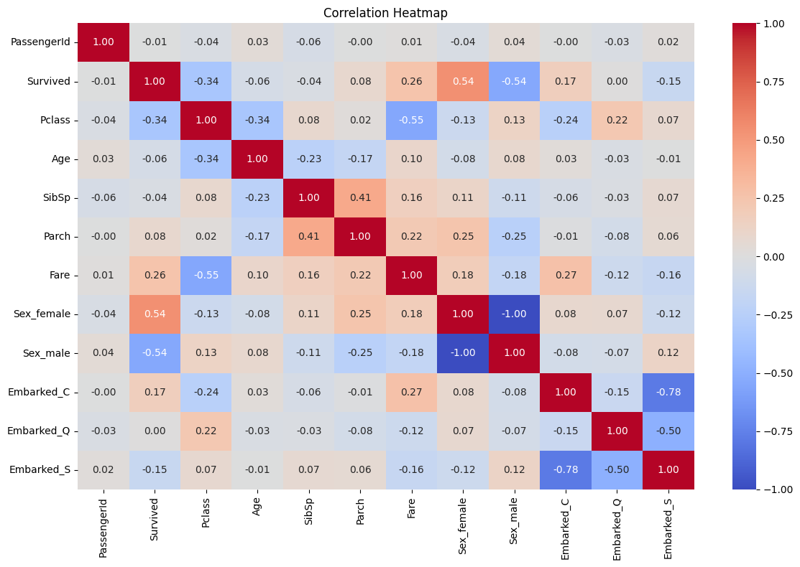

#  Data Preprocessing & Exploratory Data Analysis (EDA)

## 1. Project Overview

This project focuses on Data Preprocessing and Exploratory Data Analysis (EDA) using the Titanic Dataset.

The main objective is to clean the dataset, handle missing values, perform categorical encoding, identify patterns, and create meaningful visualizations.

## 2. Dataset Description

The Titanic dataset contains passenger information such as:

- PassengerId
- Survived
- Pclass
- Name
- Sex
- Age
- Fare
- Embarked

## 3. Tasks Performed

1. Imported libraries using Pandas, NumPy, Matplotlib and Seaborn.
2. Loaded and explored the Titanic dataset.
3. Checked dataset shape and data types.
4. Identified missing values.
5. Handled missing values using Mean, Median and Mode.
6. Removed the Cabin column due to excessive missing values.
7. Performed categorical encoding.
8. Checked duplicate records.
9. Performed Exploratory Data Analysis (EDA).
10. Created graphs and visualizations.

## 4. Data Visualizations

### 4.1 Survival Count

This graph shows the number of passengers who survived and did not survive the Titanic disaster.

### 4.2 Age Distribution

This graph represents the age distribution of Titanic passengers.

### 4.3 Passenger Class Distribution

This graph shows the number of passengers belonging to different ticket classes (1st, 2nd and 3rd).

### 4.4 Correlation Heatmap

The correlation heatmap shows the relationship between numerical features in the Titanic dataset.

## 5. Technologies Used

- Python
- Pandas
- NumPy
- Matplotlib
- Seaborn
- Jupyter Notebook

## 6. Project Files

| File Name | Description |
|---|---|
| Mission1_Data_Preprocessing_EDA.ipynb | Complete Jupyter Notebook |
| train.csv | Training Dataset |
| test.csv | Testing Dataset |
| gender_submission.csv | Sample Submission File |
| survival_count.png | Survival Count Graph |
| age_distribution.png | Age Distribution Graph |
| passenger_class.png | Passenger Class Graph |
| correlation_heatmap.png | Correlation Heatmap |

## 7. Conclusion

The Titanic dataset was successfully cleaned and analyzed. Missing values were handled, categorical variables were encoded, duplicate records were checked, and visualizations were created to understand important patterns in the dataset.

## 8. Author

**Reyan Reza**

B.Tech CSE – Machine Learning
